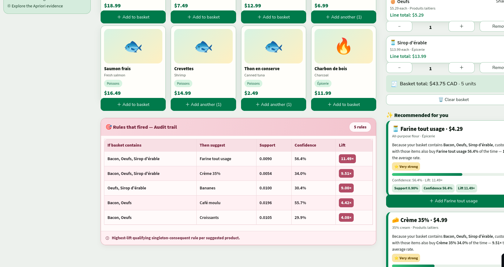
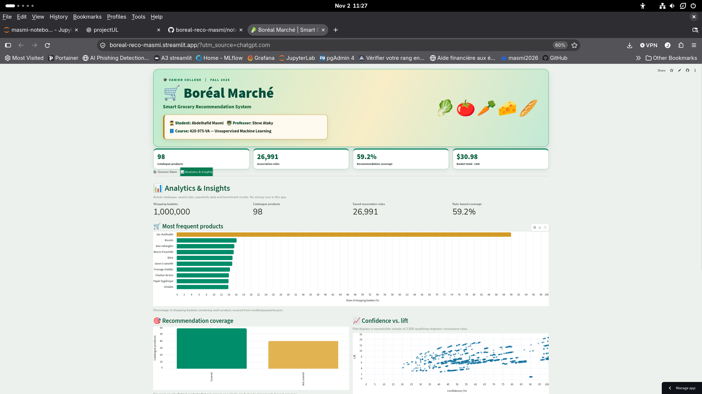

# Boréal Marché — Apriori Recommendation Engine

**Vanier College — 420-975-VA: Unsupervised Learning**

**Author:** Abdelhafid Masmi

## Project Overview

A grocery recommendation system using association rule mining
with Apriori (mlxtend).

The system analyzes 1,000,000 shopping baskets and 98 products
to recommend items based on basket contents.

## Technologies

- Python 3.12
- Pandas
- mlxtend (Apriori)
- Jupyter Notebook
- Streamlit

## Project Structure

- `notebooks/` — Data analysis and Apriori mining
- `models/` — Exported rules and metadata
- `app/` — Streamlit recommendation application
- `reports/` — Performance benchmarks
- `data/` — Local datasets (excluded from Git)

## Current Results

- Transactions: 8,379,837
- Shopping baskets: 1,000,000
- Products: 98
- Generated rules: 26,991 (lift > 1)
- Recommendation coverage: 59.2%

## Status

Streamlit application implemented, tested locally, and deployed online.

**Live application:** https://boreal-reco-masmi.streamlit.app/

## Data

The original transaction dataset is excluded from GitHub
because of its size. Place the original datasets in data/ to reproduce the mining notebook.

## Limitations

Apriori can be memory-intensive on large datasets.
Rare products may not appear in recommendations because
they do not meet the minimum support threshold.

## Installation

Requires Python 3.12.

Install dependencies:

    python -m pip install -r requirements.txt

Run Streamlit:

    streamlit run app/streamlit_app.py

## Features

- Catalogue of 98 products
- Basket with quantities and prices
- Apriori recommendations with support, confidence and lift
- Popular-product fallback
- Recommendation audit trail

## Notebook

notebooks/masmi-notebook.ipynb

## Benchmark

reports/benchmark.md

## Application Screenshots

### Main application
Catalogue, product categories, shopping basket, and project statistics.

### Apriori recommendations and rule evidence
Recommendations with support, confidence, lift, and the fired-rules audit trail.

### Analytics & Insights
Interactive dashboard showing product popularity, recommendation coverage, confidence versus lift, and Apriori benchmarks.

## Dataset and Reproducibility

The datasets were provided for the Vanier College Boréal Marché assignment.

- `data/products.csv`: product catalogue, included in GitHub.
- `data/transactions.zip`: original 36 MB archive, excluded from GitHub.
- The ZIP contains `transactions.csv` (approximately 318 MB).

To reproduce the analysis:

1. Obtain `transactions.zip` from the course materials.
2. Place it in `data/` without extracting it.
3. Install dependencies: `pip install -r requirements.txt`.
4. Open `notebooks/masmi-notebook.ipynb` in JupyterLab.
5. Run all cells in order.

The deployed Streamlit application uses the saved model artifacts
and does not require the original transaction archive.

## Recommendation Engine — Edge Cases

The application implements the five required edge cases:

1. **Empty basket:** Displays popular products as a cold-start fallback.
2. **No matching rule:** Displays an explanation and falls back to popular products.
3. **Product already in basket:** Excludes that product from recommendations.
4. **Duplicate recommendation:** Retains the qualifying rule with the highest lift.
5. **Very rare product:** Explains that insufficient support can prevent a product from appearing in frequent itemsets.

These behaviours were checked using the Streamlit interface and recommendation logic.

## Ethical and Legal Considerations

### Québec Law 25 and explainability

The application provides explanations for association-rule recommendations.
The expandable **Rules that fired** section exposes the antecedents,
recommended products, support, confidence, and lift, supporting transparency
and helping users understand why a recommendation was generated.

### Correlation does not imply causation

An observed rule in the application is **Charbon de bois → Bière**.
This is an example of the familiar retail association between charcoal
and beer. The association does not establish that buying charcoal causes
someone to buy beer. Shared shopping occasions, such as barbecues,
may help explain why these products appear together.

### Reinforcement bias

Recommending only popular products can repeatedly favour already popular
items and reduce exposure to less frequently purchased products.

The measured recommendation coverage is **59.2% (58 of 98 products)**,
highlighting this limitation. A future hybrid recommendation system
could combine association rules with product-category similarity
to improve coverage.
